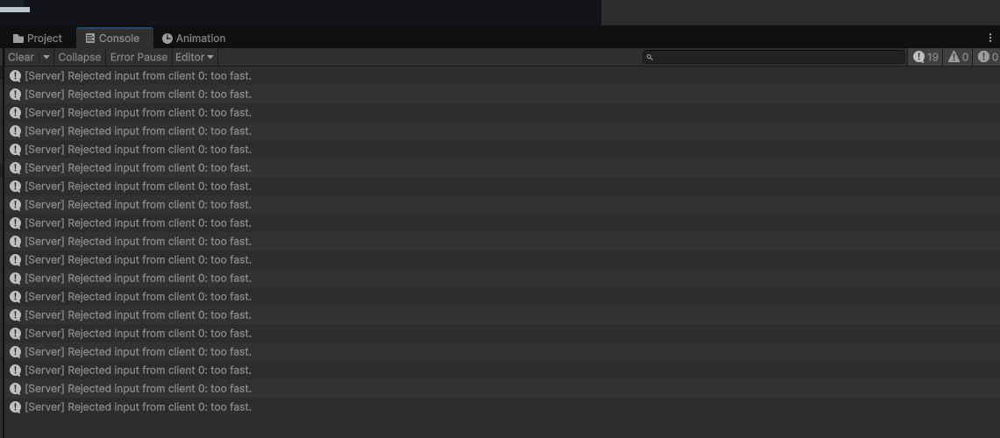

# Week 4

## Step 2

I tested one server and two clients on my PC at 30 Hz. The client RTT was 17 ms. Both paddles moved on both clients and stayed inside the court.

## Step 3

`axis = Mathf.Clamp(axis, -1f, 1f);` changes 50 to 1 and runs on the server, so the paddle moves at normal speed.

## Step 4

30 ms is just below the 33 ms between normal inputs at 30 Hz. With this tick-based timer, 5 ms still rejects inputs in the same tick, so it makes no difference at 30 Hz. At 500 ms, most normal inputs are rejected and direction changes and stopping are delayed.

## Step 5

1. C does not make the paddle 20 times faster because the server moves it once per tick using the last accepted axis, not once per RPC.
2. T only changes the client's copy, so the server's ball still uses the server's paddle position.
3. X still fails because the server clamps the axis, and T still fails because the server controls the position.

An isolated C burst rejected 19 inputs; with normal input enabled, the count was 20.

